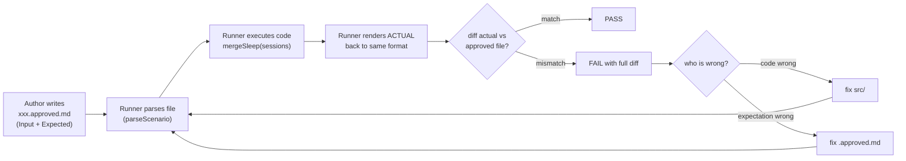
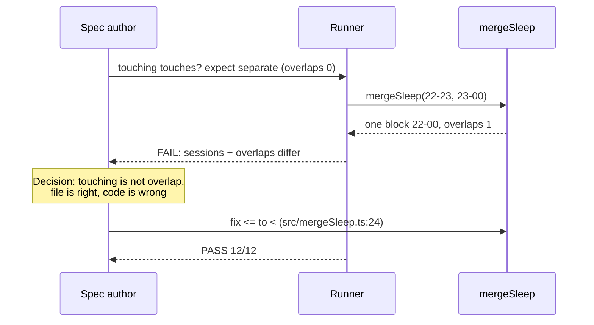

# Approved Scenarios — explained with our sleep-merger

Source: [Approved Scenarios](https://lexler.github.io/augmented-coding-patterns/patterns/approved-scenarios/) by Ivett Ördög (Augmented Coding Patterns). Special case of [Constrained Tests](https://lexler.github.io/augmented-coding-patterns/patterns/constrained-tests/). Sibling: [Approved Logs](https://lexler.github.io/augmented-coding-patterns/patterns/approved-logs/).

## The problem it solves

AI generates lots of tests fast. Reviewing dozens of assertion blocks is slow and error-prone — you stop actually checking them. Coverage stays high, confidence stays low.

Approved Scenarios flips it: **validate the runner once, then review only small fixture files** written in domain language (times, markdown tables, ASCII art — whatever a human can scan in seconds).

## The flow



Key rule: **the runner never fixes anything.** It only parses, executes, renders, and diffs. A human (or agent with approval) decides which side was wrong — exactly what we did today.

Interactive diagram of this loop (built with [archify](https://github.com/tt-a1i/archify)): [`approved-scenarios-runner.workflow.html`](./approved-scenarios-runner.workflow.html) — green path down the middle, red decision branch at the diff gate.

## The diff, line by line

The "diff" is not `git diff`. It is one string comparison in `tests/scenarios.test.ts:30`:

```ts
expect(renderScenario(scenario, result)).toBe(normalizeText(text));
```

Left side: the approved file, normalized. Right side: the input lines from that same file plus the code's **actual** output, rendered back into identical markdown. Four stages, each dumb on purpose:

1. **Parse** (`parseScenario`) — reads `## Input` lines into sessions. Throws if there is no `## Result` section or any of the three required keys is missing. A fixture without expectations cannot exist.
2. **Execute** — calls `mergeSleep(sessions)`. No mocks, no setup code; the input comes from the file.
3. **Render** (`renderScenario`) — formats the actual result with the same `sessions: …` / `total_minutes: …` / `overlaps_merged: …` lines, reusing the file's own input lines verbatim.
4. **Normalize + compare** (`normalizeText`) — LF endings, `trimEnd` every line, exactly one final newline. Then plain equality.

Because the whole file is the assertion, a failure shows **every wrong line at once**, prefixed `-` (what the file believes) vs `+` (what the code produced). Real ones from this repo:

Touching boundary (belief right, code wrong):

```diff
  ## Result
- sessions: 22:00-23:00, 23:00-00:00
+ sessions: 22:00-00:00
  total_minutes: 120
- overlaps_merged: 0
+ overlaps_merged: 1
```

Triple overlap (belief wrong, code right — 420 double-counts the overlaps):

```diff
  sessions: 22:00-04:00
- total_minutes: 420
+ total_minutes: 360
  overlaps_merged: 2
```

Note what the diff does *not* do: it never rewrites the file, never patches `src/`, never guesses intent. Blank lines are structural (an extra one after `## Input` fails the diff even when every value is right). Reading the diff and picking a side — fix the belief or fix the behavior — is the human review step the pattern is designed around.

## How we implement it here

| Piece | File | Job |
|---|---|---|
| Fixtures (spec) | `scenarios/*.approved.md` | Input sessions + expected merged result, e.g. `22:00-06:00` |
| Runner (reviewed once) | `tests/scenarios.test.ts` | Reads every `.approved.md`, runs `mergeSleep`, asserts rendered actual == file text |
| Parser + renderer | `tests/support/scenarioFormat.ts` | `parseScenario` rejects files with no `## Result` / missing keys; `renderScenario` rebuilds the file from actual output |
| Code under test | `src/mergeSleep.ts` + `src/types.ts` | Pure function, no I/O. `MergeResult` = sorted sessions + `totalMinutes` + `overlapsMerged` |

Fixture format (one "night" runs 18:00 → 18:00 next day):

```markdown
# Contained session merges into the outer session

## Input
fitbit  22:00-06:00
phone   23:00-02:00

## Result
sessions: 22:00-06:00
total_minutes: 480
overlaps_merged: 1
```

The runner (`tests/scenarios.test.ts:26-30`) is just:

```ts
const scenario = parseScenario(text);       // throws if no expected output
const result = mergeSleep(scenario.sessions); // run the code
expect(renderScenario(scenario, result)).toBe(normalizeText(text)); // one assertion
```

## Classical testing vs approved scenario

Classical Vitest for the same case — assertions in code:

```ts
import { expect, it } from 'vitest';
import { mergeSleep } from '../src/mergeSleep';

it('contained session merges into the outer session', () => {
  const result = mergeSleep([
    { source: 'fitbit', start: '2026-10-01T22:00:00Z', end: '2026-10-02T06:00:00Z' },
    { source: 'phone',  start: '2026-10-01T23:00:00Z', end: '2026-10-02T02:00:00Z' },
  ]);
  expect(result.sessions).toEqual([
    { start: '2026-10-01T22:00:00Z', end: '2026-10-02T06:00:00Z' },
  ]);
  expect(result.totalMinutes).toBe(480);
  expect(result.overlapsMerged).toBe(1);
});
```

Compare:

| | Classical | Approved Scenario |
|---|---|---|
| New case | write + review code block above | add one `.approved.md` file |
| Review | read ISO strings, `toEqual`/`toBe` | scan `23:00-02:00 → 22:00-06:00, 480, 1` |
| Missing assertions | possible (empty `it` still passes) | impossible — parser throws without `## Result` + all three keys |
| Failure output | per-assertion diff | whole-file diff, every wrong line at once |
| Scaling to 50 cases | 50 blocks to review | 50 short files to skim |

Same coverage, wildly different review cost. That is the whole point.

## What we saw today (real examples)



Two more from this repo:

* **Whitespace is spec too.** Two files had a blank line after `## Input`/`## Result`; the renderer emits none. Content was right, files still failed until we removed the blank lines. Normalization (`trimEnd`, one final newline) handles trailing spaces, not structural blank lines.
* **Wrong belief, right code.** We wrote `chain-of-three` expecting `total_minutes: 420` (sum of inputs). Runner said `360` (union `22:00-04:00`). `src/types.ts:19` defines total as sum of *merged* sessions, so the file was wrong — fixed `420 → 360`, green 13/13.

## TDD and how it relates

TDD says: red → green → refactor, with the test written first expressing intent.

Approved Scenarios is TDD with the "test" replaced by a fixture:

* **Red:** write the `.approved.md` with what you believe (e.g. touching stays separate) — it fails against current code.
* **Green:** fix code *or* expectation, whichever the review says is wrong — then it passes.
* **Refactor:** safe, because every scenario re-runs and any behavior drift shows as a file diff.

Difference from textbook TDD: the executable specification lives in data files a non-programmer can read, and the constraint (parser rejects hollow tests) guarantees every test actually asserts something. If you know TDD, you already know the loop — only the test format changed.
