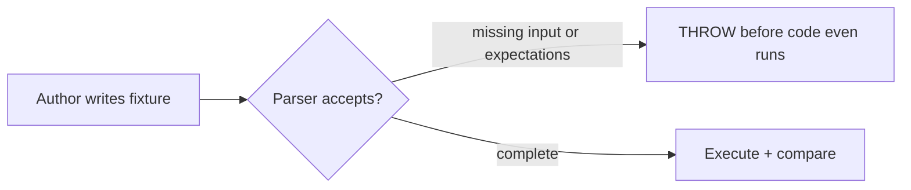

# Constrained Tests — explained with our sleep-merger

Source: [Constrained Tests](https://lexler.github.io/augmented-coding-patterns/patterns/constrained-tests/) by Ivett Ördög (Augmented Coding Patterns). Parent of [Approved Scenarios](https://lexler.github.io/augmented-coding-patterns/patterns/approved-scenarios/) and [Approved Logs](https://lexler.github.io/augmented-coding-patterns/patterns/approved-logs/). Companion doc: [`approved-scenarios-explained.md`](./approved-scenarios-explained.md).

## The problem it solves

Coverage is easy to cheat. A test can execute code without asserting anything and still count as covered:

```ts
it('contained session merges', () => {
  mergeSleep([...]); // runs fine, asserts nothing — green, worthless
});
```

No metric can catch this in general. But for one subsystem with a constrained domain, you can design the test format so that writing a test *without* sufficient assertions is impossible.

## The pattern in one diagram



The parser is the constraint. It sits in front of the code under test and refuses to run hollow fixtures. We saw it live: a scenario file with an `## Input` but no `## Result` failed with:

```
Error: A scenario needs a "## Result" section: without expected output it is not a test
```

at `tests/support/scenarioFormat.ts:101`, thrown from `tests/scenarios.test.ts:23` — step 1 of the runner, before `mergeSleep` is ever called. A file that asserts nothing can never be green.

## How we implement it here

Three layers, each in one file:

| Layer | File | Constraint |
|---|---|---|
| DSL shape | `tests/support/scenarioFormat.ts:26` | `RESULT_KEYS = ['sessions', 'total_minutes', 'overlaps_merged']` — all three required |
| Parse-time rejection | `tests/support/scenarioFormat.ts:86-114` | no `# Title` → throw; no `## Input` → throw; no `## Result` → throw; any missing key → throw; malformed `HH:MM-HH:MM` → throw; zero-length session → throw |
| Single assertion | `tests/scenarios.test.ts:30` | whole rendered file compared at once — there is no code path that runs without comparing |

External DSL (data files + custom parser), not an internal fluent API — deliberate. A data format can be *rejected*; a fluent chain cannot easily be proven complete.

## Why coverage becomes trustworthy

With the constraint in place, every collected test file guarantees: it ran the code **and** compared all three outputs. So file count ≈ assertion strength, and coverage of `src/mergeSleep.ts` actually means exercised-against-expectations. The format tests (`tests/scenarioFormat.test.ts`) guard the guard itself — they assert the parser throws on each hollow variant.

## Relation to the other two patterns

* **Approved Scenarios** = Constrained Tests optimized for review ease (domain-readable fixtures).
* **Approved Logs** = Constrained Tests optimized for bug-repro speed (log files as fixtures, first line = invocation).
* Both inherit the same deal: the runner is reviewed once, the parser makes hollowness unrepresentable, new cases are data.
